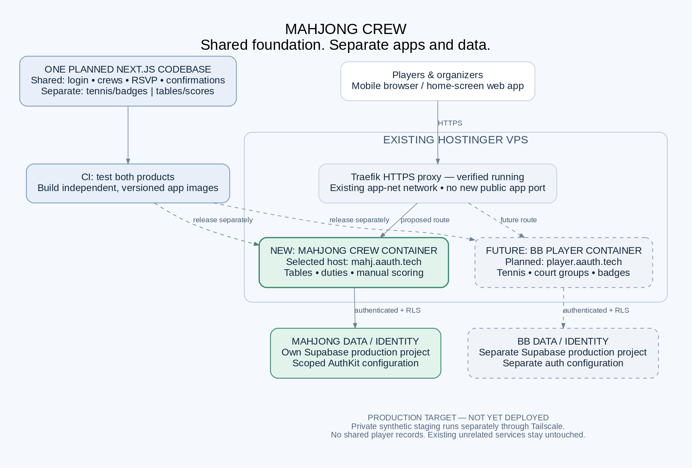

# Mahjong Crew — BB Player reuse and Hostinger recommendation

**Status: the approved silver/grey synthetic-data prototype is implemented and deployed in an isolated private Hostinger staging container with Tailscale access. Auth, persistence, independent product builds, public DNS, and production deployment remain unimplemented.** See the [prototype guide](PROTOTYPE.md) and [staging verification](evals/2026-10-16-private-staging.md).

**Confirmed user choices:** American Mahjong as the initial default; multiple tables and matches with card year, house rules, and scoring convention selected per game session; production hostname `mahj.aauth.tech`; a silver/grey, sleek, Luma-inspired prototype with simple navigation. Preserve historical rules/results and keep incompatible scoring systems separate in rankings. Additional Mahjong variants remain future scope. These product choices do not themselves authorize infrastructure changes or establish that DNS/TLS or deployment is configured.

## 1. Recommendation

Build **Mahjong Crew as a separately branded and deployed companion app**, using BB Player's planned club-management foundation. Use one small Next.js/TypeScript codebase for common functions, with distinct BB and Mahjong modules and independently released app images. Run Mahjong in a **new Docker Compose project/container on the existing Hostinger VPS**, behind its existing Traefik HTTPS proxy.

Keep each product's membership, application data, credentials, and authentication configuration separate. **Share code, not player records or production secrets.** Do not turn BB Player into Mahjong, merge the two communities, or build a general-purpose sports platform first.

The important qualification at the original review: **the checkout contained BB Player requirements and a development plan, not a functioning BB app to clone.** A runnable Mahjong synthetic-data prototype has since been added, but BB functionality, auth integration, and database migrations are still unimplemented. This remains reuse of a strong BB product blueprint and technology direction, not a clone of a finished BB application. There is no defensible production code-reuse percentage or delivery estimate yet.

Recommended priorities:

1. Make organizing a reliable four-player table effortless.
2. Add simple, manually recorded American Mahjong scores, with card year and agreed house rules selected per game session.
3. Add richer discovery, additional scoring rules, and analytics after actual use.

## 2. What was reviewed and verified

- **Source flows:** the supplied `Mahjong-Flows-1792188355586-cfuf1i.pdf`, one tall PDF page containing four sections: Main User Flow, Availability Polling Flow, Score Tracking Flow, and Friend Discovery Flow. Both its text and rendered diagrams were reviewed.
- **BB foundation:** [README](../README.md), [product specification](PRODUCT-SPEC.md), and [development plan](DEVELOPMENT.md). These remain the canonical BB requirements; this proposal does not change them.
- **Hostinger, read-only snapshot on 2026-10-16 at approximately 22:08 UTC:** Docker is running, Traefik serves HTTPS on ports 80/443, and existing apps use its external `app-net` network with the `letsencrypt` resolver. The host reported about 7.8 GiB RAM, 2.1 GiB available, 45 GB free disk, and no swap. This is a point-in-time capacity check, not a load test or uptime guarantee.
- No running BB Player application container was found in that inventory. A stopped, BB-named backup utility is not an application deployment and was not treated as reusable app code. Its contents were not inspected.
- During the original review, no containers, databases, DNS, auth clients, or existing production services were changed. Subsequently, the user approved private staging: a new isolated application container and narrowly scoped Tailscale Serve entry points were added. Existing routes/containers, databases, public DNS, and auth clients were left unchanged; no player messages were sent.

## 3. Fit between the supplied flows and BB Player

| Supplied Mahjong flow | BB foundation to carry forward | Mahjong-specific work / recommendation |
| --- | --- | --- |
| Welcome → sign in → dashboard | Planned low-friction email-code login, invitation-only membership, mobile-first interface | Mahjong branding, crew onboarding, next game and outstanding RSVP as the main actions. An event invite should return to that event after login, not lose the user at the dashboard. |
| Organizer creates poll and invites players | Planned events, slots, availability, organizer roles, manually shared signup links | Poll across candidate dates as well as times; add response deadline, venue, ruleset, and table count. Invite existing crew members before requiring a separate friends system. |
| Players respond → organizer sees best slots | Explicit distinction between availability, maybe, confirmation, and waitlist | Rank candidate slots by viable complete tables and show who has not replied. An available response is not a booked seat. |
| Schedule game | Organizer-approved groups of four, non-overlapping assignments, substitutes | Courts become tables. Add table/seat assignments and explicit final invitations/acceptances. Do not quietly treat five to seven players as two complete tables. |
| Player assignments / event duties | Organizer attribution and event administration patterns | New duty records for host, tiles, racks, refreshments, and scorekeeper, with acknowledgement. Duties are not the same thing as table seats or player permissions. |
| American / Chinese score entry → summaries | No implemented equivalent; BB's current first slice does not include scoring | New game sessions, hands/rounds, ruleset metadata, per-player results, review/correction history, and summary screens. This is substantive new product work. |
| Integrated stats and player profiles | Planned member visibility and privacy controls | A common history timeline is useful. Keep scores and rankings separate by variant/ruleset; raw points from different systems are not comparable. |
| Name search, QR scan, invite link → friends | Planned invitation-only group access | Start with crew invitations and a private member list. Later add explicit, consensual friend connections. A friend connection must never automatically grant crew membership or reveal private venues. |
| Settings and demographic themes | BB's friendly, older-adult-oriented product direction | One accessible interface for everyone; optional text-size/contrast preferences instead of guessing ability from age. |
| Tournament mode, cloud messaging, offline, app-store payments | Later capabilities, not prerequisites | Keep tournaments and payments out of the pilot. Start with manual communication and online saving; add offline drafts and notifications only with a clear sync/consent design. |

### What not to carry over

- Broken Bodies' ailment badges, health-related fields, and factor/blocker rules do **not** belong in Mahjong Crew. Mahjong availability stands on its own.
- Do not hard-code Monday, tennis start times, courts, or Friday noon Pacific into shared scheduling logic. Store event time zones explicitly; use the BB recurrence only in BB.
- Do not import real BB members, historical notes, or private WhatsApp content into a demo or into Mahjong. Invite people afresh with their consent.
- Do not implement the PDF's React Native/Flutter, Firebase, cloud messaging, and app-store payments merely because they appear in its technology panel. The workflows do not require those choices.

## 4. Recommended changes to the flows

### A. Main flow: put the next action before the feature catalogue

Keep the first screen focused on the next game, a pending availability response, and a clear **Respond / View game** action. The organizer additionally sees **Create poll** and **Review responses**. History, crew members, and settings are secondary destinations. Keep tournament controls out of the pilot rather than showing a disabled promise.

Use readable text, strong contrast, approximately 44–48 px touch targets, labelled icons, keyboard access, and clear save/error messages. Test with older players rather than creating three age-labelled interfaces.

### B. Polling: add the missing commitment and cancellation steps

Recommended loop:

**Create poll → invite crew → collect availability → review complete-table options → choose time/venue → invite selected players to confirm → publish confirmed tables → play → record results.**

Cancellation and substitute handling remain available after publication. A cancellation that leaves three players must be obvious to the organizer, not hidden by a stale “four available” count.

Model these separately:

- Poll lifecycle: draft → open → closed or cancelled.
- Player availability per candidate slot: available / maybe / unavailable; no response is its own state.
- Final participation: invited → accepted / declined; waitlisted and cancelled are explicit alternatives. Only accepted seats count as confirmed places.
- Scheduled event lifecycle: proposed → confirmed → completed or cancelled. Confirming the event requires an explicit organizer action and enough accepted players for its published tables.

Selecting multiple candidate slots expresses flexibility, not multiple bookings. Default to four accepted players per standard table. Three-player variants or five-player rotations require a separately approved rule, not an accidental fallback. Allow an organizer to propose a substitute; do not silently commit someone to a newly selected time. Record when an organizer responds on someone's behalf.

Resolve simultaneous seat claims transactionally. On cancellation, release the seat and notify the organizer; a waitlist promotion sends an invitation, not an automatic acceptance. Changes to a confirmed time, venue, or ruleset require a visible update and renewed confirmation where appropriate. Private home addresses should be disclosed only to authorized event participants and organizers, not in public previews.

### C. Scoring: specify the rules before building a calculator

**American Mahjong is confirmed for the initial release.** Capture manually entered hand reference, NMJL year, winner/draw, and the results or agreed per-player point changes. The group must define whether “points” means a hand value or a settlement total. Do not imply that a manual entry was rules-validated.

**Allow different rulesets for different games, not one permanent app-wide scoring choice.** Recommended structure:

- A scheduled event holds the invitation, time, venue, and an American Mahjong default ruleset.
- An event can have several tables; each table can have successive game sessions containing multiple hands/rounds.
- Each session selects one supported, versioned ruleset profile: Mahjong variant, card year where applicable, house rules, and point convention. Start with agreed American profiles; do not offer unsupported variants as working scoring modes.
- A table/session may override the event default before play. Show the actual rules to its players; a material change after seat acceptance requires renewed confirmation.
- Once scoring starts, preserve that session's ruleset snapshot. To play under different rules, finish or close the session and start another. Changes to crew defaults or saved profiles must not rewrite previous results.
- Example: an afternoon event can have one table playing the crew's standard American rules and another using an agreed American house-rule profile. A later session can use another supported profile without affecting earlier scores.

This supports multiple matches and future Mahjong variants in the same app without building every scoring calculator now. Keep manual American score recording as the first implementation. “Chinese Mahjong” is not a sufficiently precise scoring specification; any future Chinese profile needs an exact variant and house rules.

For a later Chinese-rules release, define the exact fan system, dealer/seat information, winning method, applicable limits/multipliers, and settlement rules before adding calculations. Do not ship a generic “fan × points” formula as if it applies to every Chinese variant.

Use a designated scorekeeper per table; participants can view results and request corrections. Permit another participant to take over explicitly. Record editor, timestamp, revision, and reason for corrections; finalize a session after review. Prevent duplicate hand submissions and conflicting edits from two phones. Handle draws and unfinished sessions explicitly.

Manual references are preferable to copying a commercial card's contents. **Verify rights before embedding, scanning, distributing, or validating against NMJL card material.** This review does not establish a content licence. Keep point recording separate from wagers or payment processing.

A shared history can show both variants, but leaderboards and averages should be scoped to a compatible ruleset/version. Keep personal history distinct from crew-visible statistics.

### D. Discovery: replace implicit access with deliberate consent

The PDF gives name requests an approval step, but QR/link routes an “instant connection / direct add.” Make that safer without making it cumbersome:

- A QR code or link opens a preview of the inviter and intended action, followed by an explicit **Accept** after sign-in. Scanning alone must not create a relationship.
- Do not consume an invitation or change membership on a GET request; messaging previews and security scanners open links automatically.
- Use unpredictable, scoped, expiring, revocable tokens and atomic redemption. Use one-time invites by default; a reusable crew link needs an explicit use limit and organizer policy.
- Keep friend acceptance separate from crew membership and event invitations. Removing a friend must not rewrite match history.
- Start with search inside the crew. Any later global name search must be opt-in, rate-limited, and avoid exposing emails or enabling account enumeration.
- Provide remove/block/report controls when broader discovery launches. A connected friend sees only what the player has chosen to share, not all history or private location details.

## 5. Implementation architecture

### Shared foundation, product-specific modules

Retain the proposed **Next.js + TypeScript, WorkOS AuthKit, Supabase Postgres/RLS, and Hostinger Docker** direction. Deliver a responsive web app first, with install-to-home-screen/PWA support when useful. Native apps are not needed to validate this companion workflow.

When implementation is approved, use one repository/codebase with:

- **Common code:** accessible UI components, identity-to-member mapping, crew roles, invitations, generic events and candidate slots, availability, confirmations, waitlists, audit records, and communication copy generation.
- **BB module:** tennis courts, Monday recurrence, doubles scheduling, and consent-controlled badges with weekly blockers.
- **Mahjong module:** table seats, duties, rulesets, game sessions, score entry, results, and member connections.

Keep product selection server-controlled and validated at build/startup. This is not a request for a plugin framework, microservices, or a broad monorepo toolchain. Extract common modules only as concrete implementation needs arise. Keep BB-specific routes/data migrations out of the Mahjong deployment and vice versa. Hiding a menu is not authorization: wrong-product endpoints must reject access too.

Run CI for both products when common code changes, but deploy each independently from an immutable commit/image. A Mahjong release must not automatically restart or upgrade BB. This proposed structure needs approval before changing BB's existing development plan.

### Data and access boundaries

Use **separate Supabase projects for the products' production data**, and a separate Mahjong staging project before using real players. Separate projects reduce the chance of a missing product filter exposing another community. They have plan/cost implications to approve before provisioning. Within each app, still enforce crew- and user-aware RLS; a separate database does not replace authorization.

Initial record groups:

| Records | Purpose |
| --- | --- |
| Member profiles, crews, memberships | Map verified identity to active player/organizer permissions; roles belong to a crew, not a global “organizer” flag. |
| Invitations | Typed crew/event/friend scope, inviter, recipient or redemption policy, expiry, revocation, and acceptance. |
| Polls, candidate slots, responses | Candidate start/end times, time zone, deadline, response state and source, and update timestamps. |
| Events, tables, seat assignments, duties | Final venue/time, capacity, invited/accepted/waitlisted state, responsibility acknowledgement, and organizer decisions. |
| Game sessions, ruleset versions, hands/rounds, result entries/revisions | Table participants, selected scoring rules, manually entered results, finalization, and correction audit trail. |
| Connections and sharing preferences | Separate consent for friendships and profile/stat visibility; may follow the pilot. |

WorkOS login does not confer membership. Preserve the existing plan's explicit WorkOS-to-Supabase integration and authenticated-role requirements; do not assume WorkOS subject strings are Supabase Auth UUIDs. Test with different members and organizers, not only an administrative/service-role client. Bind sign-in/invite redirects to approved origins to prevent open redirects.

Use separately scoped AuthKit clients/environments where supported, product-specific callbacks and cookie secrets, and host-only session cookies. Signing into one app must not enroll a person in the other. Verify provider configuration in staging before promising single sign-on.

## 6. Hostinger deployment recommendation

*Proposed production topology, not the private staging topology. Production product boxes are not deployed; synthetic staging runs separately through Tailscale. [Editable diagram source](assets/mahjong-deployment.dot).*

| Item | Recommendation |
| --- | --- |
| Compose project | New `/docker/mahjong-crew/` project, with its own app service and deployment credentials. Leave other projects and the BB backup alone. |
| Hostnames | User-selected production hostname: `mahj.aauth.tech`. Suggest `mahj-staging.aauth.tech` for staging, still subject to approval. DNS availability/routing and TLS remain unverified and unconfigured by this work. |
| Runtime | A production Next.js standalone Node image, built/tested in CI and pulled by immutable digest or commit tag. Match the VPS architecture. Do not run a dev server or agent runtime as the public app. |
| Routing | Attach only the app service to the existing `app-net`; use uniquely named Traefik router/service labels, the approved Host rule, `websecure`, `letsencrypt`, and an internal app port such as 3000. Publish no extra host port. No need to restart the proxy. |
| Data | Supabase managed Postgres outside the VPS. No new local database container for the initial release. Database migrations are a separately gated release action, not an app-startup side effect. |
| Resource budget | Start staging with a proposed 512 MiB reservation and 1 GiB memory limit, plus a CPU limit, then measure idle and realistic concurrent use. These are trial budgets, not verified sizing. Build off-host. Recheck headroom before running staging and production together. |
| Isolation | Run as a non-root user, drop unneeded capabilities, use `no-new-privileges`, and do not mount the Docker socket, host directories, or agent credentials. Use a read-only filesystem where compatible, with narrowly scoped writable cache/tmp paths. |
| Secrets | Separate protected env/secrets per environment, never committed. Keep WorkOS API keys, session secrets, and privileged database credentials server-side. Use ordinary authenticated access with RLS for player actions. |
| Operations | Health check, restart policy, bounded log rotation, error monitoring without tokens/private score payloads, and alerts for failed health checks or high resource use. Verify startup and dependency-failure behavior. |
| Recovery | Keep the previous image digest, use backward-compatible migrations, and rehearse restoring Supabase data. An image rollback alone cannot undo a destructive database migration. Verify backup retention/restore capability for the selected Supabase plan. |

**Capacity conclusion:** a small pilot application appears plausible on the existing VPS, but the approximately 2.1 GiB available memory and lack of swap make headroom important. Do not add an entire local Supabase stack, a build worker, and two unbounded app instances there. A container is process isolation, not a separate server or immunity from another service exhausting host memory.

**Cost conclusion:** a new container may avoid another VPS subscription if measured capacity is sufficient. It does not make the app free: verify Supabase project limits/backups, WorkOS environment/pricing limits, email delivery, registry/CI, and monitoring before approving operating cost. No current pricing was researched and no paid service was provisioned for this recommendation.

## 7. Delivery plan and release gates

| Increment | Deliverable | Exit gate |
| --- | --- | --- |
| 0 — Confirm scope | American Mahjong and `mahj.aauth.tech` are selected. Confirm independent deployment scope, staging hostname, pilot crew, four-seat table rule, American scoring profiles, and privacy defaults. | Explicit remaining decisions; no infrastructure changes yet. |
| 1 — Synthetic prototype | Login placeholder clearly labelled; invitation/availability screens, organizer results, table confirmation, duty assignment, and a simple score-entry mock. | Review on an actual phone with organizer and players; no claim that mock data is securely persisted. |
| 2 — Working scheduling slice | Staging AuthKit + Supabase/RLS, real invitations/RSVPs, organizer-approved final time, accepted seats, cancellation/substitutes, private venue, and copyable messages. | Unit, authorization, concurrency, and browser tests pass; unauthorized access fails. |
| 3 — Pilot scoring | Manual American hand/round entry, supported card-year/house-rule profiles selected per session, review/finalization, corrections, and ruleset-scoped history. | Crew checks paper examples, draw/correction cases, separate concurrent tables, and a new session using different rules without altering prior results. |
| 4 — Hostinger staging and pilot | Approved isolated container/HTTPS deployment with synthetic staging data first; restore/rollback check and a separately approved real-player pilot. | Lint, typecheck, tests, production build, mobile end-to-end checks, login callback, capacity check, and recovery drill pass. Production/DNS require explicit approval. |
| Later | Additional Chinese rulesets, opt-in friend discovery/search/QR, richer statistics, notifications, offline drafts, and tournaments. | Prioritize from pilot evidence; do not bundle these into the first scheduling release. |

Use existing WhatsApp/text/email channels to share links manually in the pilot. The app/database is the authoritative response record. Do not assume an unofficial WhatsApp bot or group API works. Any later automated messaging needs a verified provider capability, recipient consent, and delivery/retry controls.

Offline support should start, if needed, with clearly marked unsynced score drafts and stable submission IDs. Never show a draft as server-saved. Define conflict handling and local-data clearing before caching private records on shared devices; online-first is acceptable for the pilot. Do not cache authenticated rosters or private venues in a public/shared service-worker cache.

### Minimum acceptance checks

1. An invited player signs in and returns to the correct poll; a nonmember cannot see its roster or venue.
2. A player chooses multiple candidate times but receives no overlapping accepted seat assignments.
3. Maybe, no response, availability, and an unaccepted invitation never count as confirmed seats.
4. Two concurrent acceptances cannot fill the same seat or overbook a table; repeat submissions are idempotent.
5. Five to seven respondents do not produce two complete four-player tables.
6. A confirmed player's cancellation releases the seat, flags the incomplete table, and offers an eligible substitute a new invitation.
7. Organizer-entered responses, table changes, and score corrections are attributable. Ordinary players cannot alter someone else's availability or finalized scores.
8. A QR/link preview bot cannot consume an invitation; expired/revoked links fail; friendship alone grants no crew/event access.
9. Separate tables/sessions can select different supported American profiles. Changing a default or starting a new session with different rules does not alter previous scores. American results retain their recorded year/ruleset; future Chinese results retain their selected variant/version. Raw points from incompatible rulesets are not mixed in a leaderboard.
10. Duplicate hand submission is prevented, a draw is supported, and a correction leaves an audit trail without silently rewriting a finalized result.
11. Mahjong cannot expose BB badges, members, cookies, or credentials, even through a direct API call. Common-code changes pass both products' tests.
12. A Mahjong container rollback leaves unrelated Hostinger apps untouched, while a tested database restore procedure exists separately.

## 8. Remaining decisions before implementation

1. **Product/hosting:** approve one codebase, independent product images/containers, and isolated data/auth environments rather than replacing BB. Production will target the selected `mahj.aauth.tech`; confirm the proposed staging hostname and authorize deployment/DNS changes separately.
2. **Pilot:** identify the initial crew, organizer, time zone, venue privacy policy, and whether four players per table is the initial standard. Recommendation: one private crew first, while retaining crew-scoped permissions.
3. **Scoring:** American Mahjong is selected. Confirm the initial NMJL year, supported house-rule profiles, and point convention. Recommendation: save these per session, allow multiple matches/tables, and keep initial scoring manual; additional variants and automatic card validation are not included by this choice.
4. **Scope/cost:** approve scheduling + duties + basic manual scoring as the pilot, with native apps, payments, tournaments, global discovery, and automated messaging deferred. Approve provider plans only after checking their actual environment and backup limits.

**Bottom line:** BB Player is a good foundation because both products are private clubs coordinating reliable groups of four. The best reuse is the identity, membership, availability, confirmation, and substitute machinery. Mahjong scoring and connection consent deserve their own design. Start with an isolated Mahjong pilot on the existing Hostinger infrastructure, without importing BB's tennis/health model or pretending the existing repository is already a built app.
